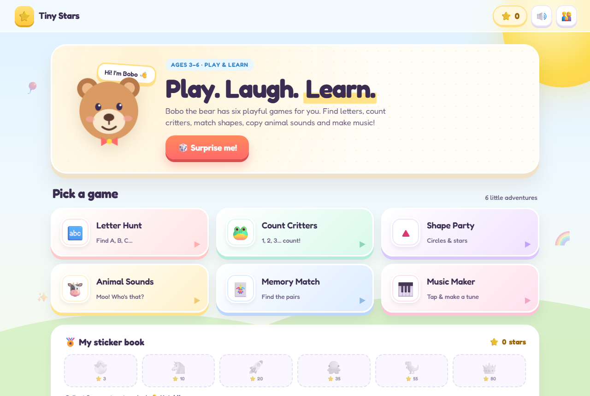

# 🌟 Tiny Stars — Play, Laugh, Learn

A playful, voice-guided learning web app for nursery-age children. Six mini-games, a friendly bear mascot, and stars to collect — learning that feels like play.

**▶ Live demo: [tiny-stars.vercel.app](https://tiny-stars.vercel.app)**



## Why it's built this way

- **Tap-first, no reading required.** Every question is spoken aloud, and every answer is a big, colourful target.
- **Encouraging, never punishing.** A wrong tap just fades away with "almost — try again". A star is awarded for every solved question, so effort always pays off.
- **Instant feedback.** Confetti, cheerful sound effects and spoken praise after every correct answer.

## The games

| Game | What it teaches |
| --- | --- |
| 🔤 **Letter Hunt** | Letter recognition, letter sounds and first-letter words (A–Z) |
| 🐸 **Count Critters** | Counting 1–5 (or 1–10), number recognition |
| 🔺 **Shape Party** | Shapes, colours, and combined shape + colour matching |
| 🐮 **Animal Sounds** | Listening skills and animal vocabulary |
| 🃏 **Memory Match** | Memory, attention and turn-taking |
| 🎹 **Music Maker** | A playable xylophone plus three nursery tunes |

## Rewards

- ⭐ **Stars** for every question answered correctly
- 🎁 **Six unlockable stickers** at 3, 10, 20, 35, 55 and 80 stars
- 👑 A crown for collecting them all

## Parent corner

Hidden behind a simple `3 + 4` gate (so little fingers don't wander in):

- Voice narration on/off
- Sound effects on/off
- Counting range: up to 5 or up to 10
- Reset all progress (two-tap confirm)

Progress is saved in `localStorage`, so each device remembers its own stars.

## Tech

A single self-contained `index.html` — no build step, no dependencies, no tracking.

- Vanilla HTML/CSS/JS
- Web Speech API for narration
- Web Audio API for generated sound effects and the xylophone (no audio files)
- Canvas for the confetti
- Fully responsive, tested at 360 px wide and up
- Honours `prefers-reduced-motion`
- Keyboard shortcuts `1`–`4` for answers, `Esc` to close the parent panel

## Run it locally

Just open `index.html` in a browser, or serve the folder:

```bash
npx serve .
```

Deep links open a game directly, e.g. `index.html#memory`.

## Deploy

Static site — any host works. This copy is deployed to Vercel:

```bash
npx vercel deploy --prod
```

---

Made for small humans with big curiosity. 💛
